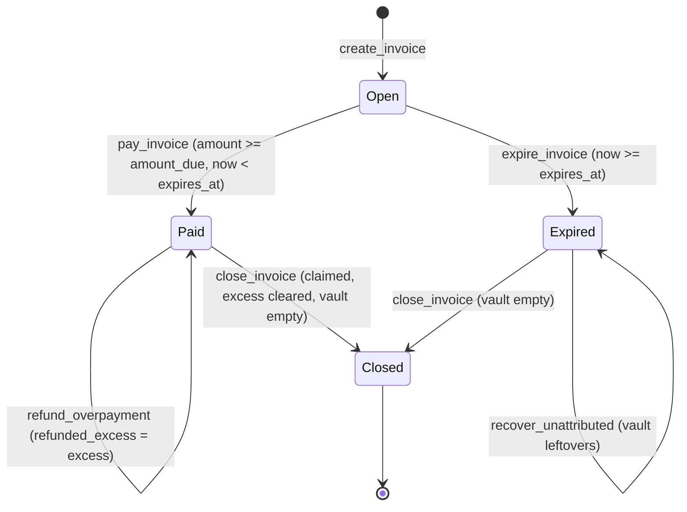

# Paytruth State Machine

States: `Uninitialized` (no account) → `Open` → `Paid` or `Expired`. `Paid` carries two independent flags, `claimed` and `refunded_excess`, then → `Closed` (`close_invoice`, account gone). Paid invoices never transition to Expired.

## Diagram

Open invoices cannot be closed. `recover_unattributed` does not change status; it only empties leftovers so `close_invoice` can run.

Note: a fresh create on a previously closed invoice_id produces a NEW Open invoice (PDA re-init after close is expected behaviour). While the account exists it cannot be re-initialized.

## Transition table

| Instruction | Caller | From | Preconditions | Effects | Event |
|---|---|---|---|---|---|
| `initialize_config` | authority | — (Uninitialized) | config PDA not yet created; mint owned by classic Token program; decimals == 6 | Config created (authority, usdc_mint, bump) | — |
| `create_invoice` | merchant | — (Uninitialized) | amount_due > 0; expires_at > now; mint == config.usdc_mint; Invoice PDA free | Invoice Open; payer = default; paid_amount = 0; refunded_excess = 0; claimed = false; escrow ATA created | InvoiceCreated |
| `pay_invoice` | payer | Open | status == Open; now < expires_at; amount > 0; amount >= amount_due; mint/escrow/ATA checks | transfer amount payer→escrow (atomic); payer set; paid_amount = amount; status = Paid | InvoicePaid |
| `merchant_claim` | merchant | Paid | status == Paid; claimed == false; signer == merchant | transfer amount_due escrow→merchant ATA; claimed = true | InvoiceClaimed |
| `refund_overpayment` | any (fee payer) | Paid | status == Paid; paid_amount > amount_due; refunded_excess == 0; dest ATA authority == invoice.payer | transfer excess escrow→payer ATA; refunded_excess = excess | OverpaymentRefunded |
| `expire_invoice` | any (fee payer) | Open | status == Open; now >= expires_at | status = Expired | InvoiceExpired |
| `recover_unattributed` | merchant | Expired **or** Paid(claimed ∧ excess cleared) | terminal; excess cleared; escrow.amount > 0; signer == merchant; dest authority == merchant | transfer escrow.amount escrow→dest ATA | UnattributedRecovered |
| `close_invoice` | merchant | Expired **or** Paid(claimed ∧ excess cleared) | terminal; excess cleared; escrow.amount == 0; signer == merchant | close escrow to merchant; close Invoice to merchant → Closed | InvoiceClosed |

## Flag truth table (Paid)

| claimed | paid > due | refunded_excess | vault may hold | claim | refund | recover | close |
|---|---|---|---|---|---|---|---|
| false | no | 0 | yes | ✓ | ✗ (NothingToRefund) | ✗ (not claimed) | ✗ |
| false | yes | 0 | yes | ✓ | ✓ | ✗ (excess outstanding) | ✗ |
| true | no | 0 | maybe | ✗ (AlreadyClaimed) | ✗ | ✓ if vault>0 | ✓ if vault==0 |
| true | yes | 0 | yes | ✗ | ✓ | ✗ (excess outstanding) | ✗ |
| true | yes | =excess | maybe | ✗ | ✗ (AlreadyRefunded) | ✓ if vault>0 | ✓ if vault==0 |
| — (Expired) | — | — | maybe | ✗ | ✗ | ✓ if vault>0 | ✓ if vault==0 |

## Rejected transitions (and the error)

| Attempt | Result |
|---|---|
| `pay_invoice` when status Paid/Expired | `DuplicatePayment` |
| `pay_invoice` after expires_at while still Open | `InvoiceExpired` |
| `pay_invoice` amount < amount_due | `Underpayment` (no transfer, no state) |
| `pay_invoice` amount == 0 | `InvalidAmount` |
| `expire_invoice` before expires_at | `NotExpired` |
| `expire_invoice` on Paid | `InvoiceNotOpen` (paid invoices cannot expire) |
| `merchant_claim` on Open/Expired | `InvoiceNotPaid` |
| `merchant_claim` twice | `AlreadyClaimed` |
| `refund_overpayment` twice | `AlreadyRefunded` |
| `refund_overpayment` when no excess | `NothingToRefund` |
| refund destination ATA not owned by recorded payer | `InvalidPayerAta` |
| `close_invoice` with non-empty vault | `VaultNotEmpty` |
| `recover/close` before terminal / excess outstanding | `InvoiceNotTerminal` / `ExcessOutstanding` |
| `recover_unattributed` with empty vault | `NothingToRecover` |
| wrong merchant signer on claim/close/recover | `UnauthorizedMerchant` |
| `create_invoice` with PDA seeds of a different merchant | Anchor seeds constraint failure |
| `expire_invoice` on already Expired | `InvoiceNotOpen` |
